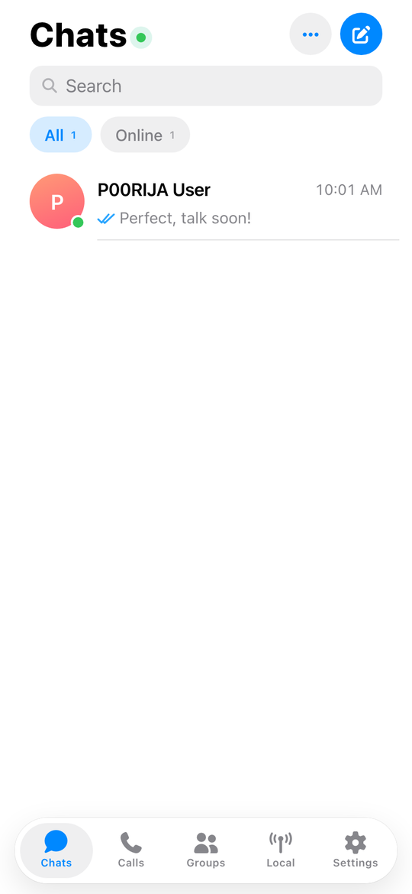
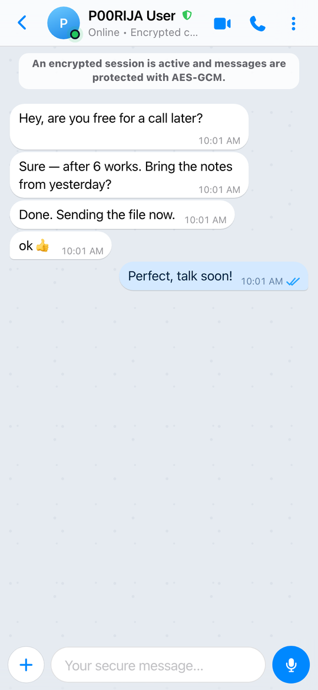
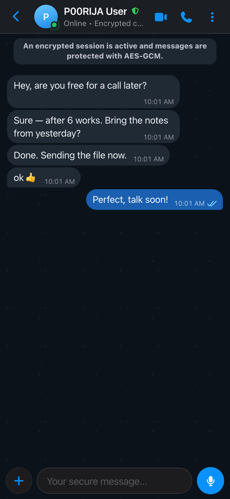
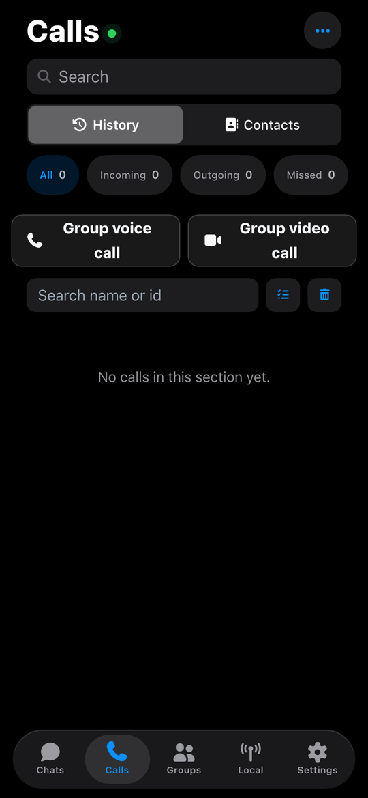
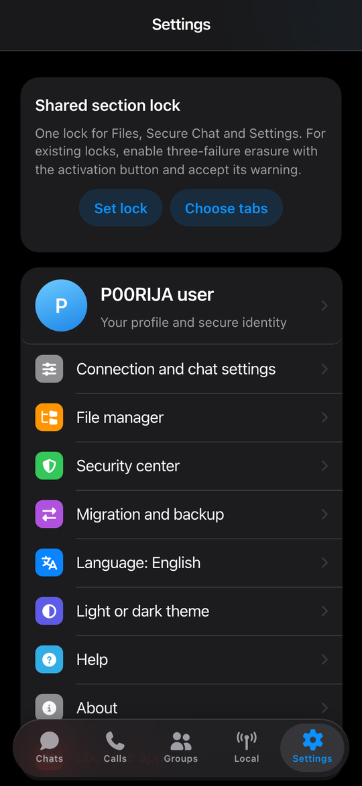
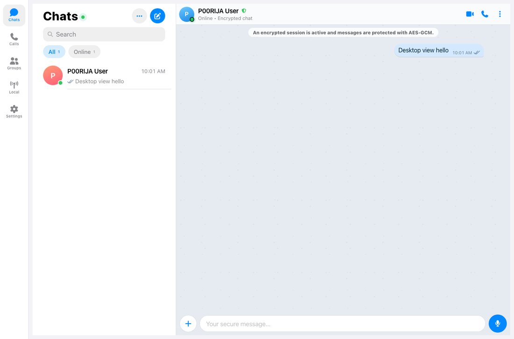
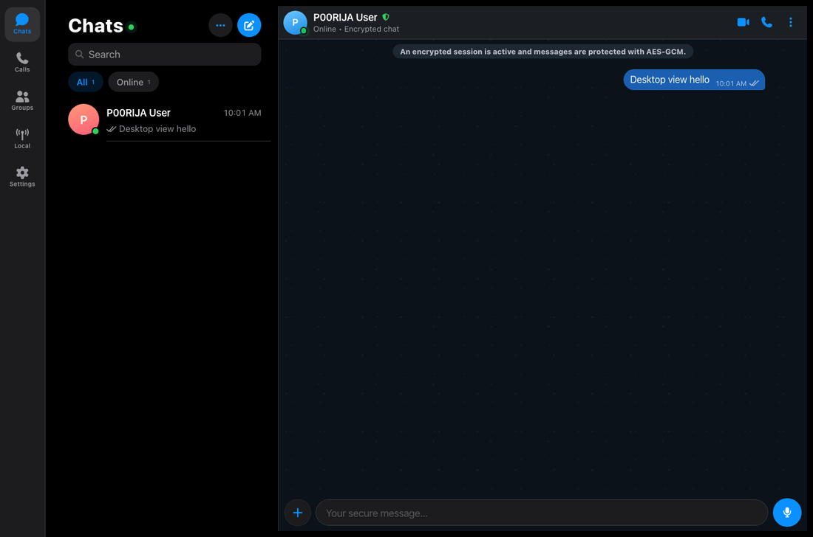
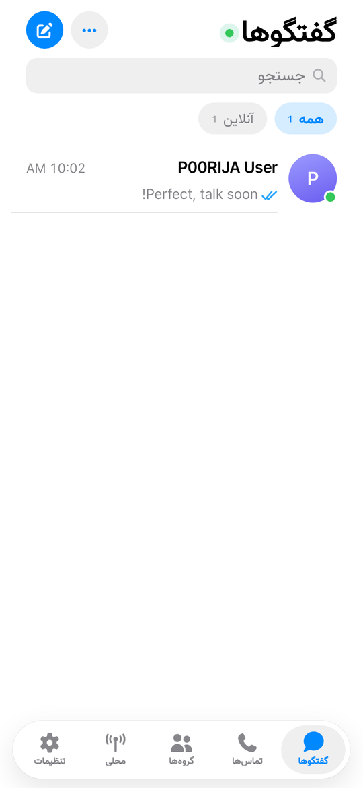
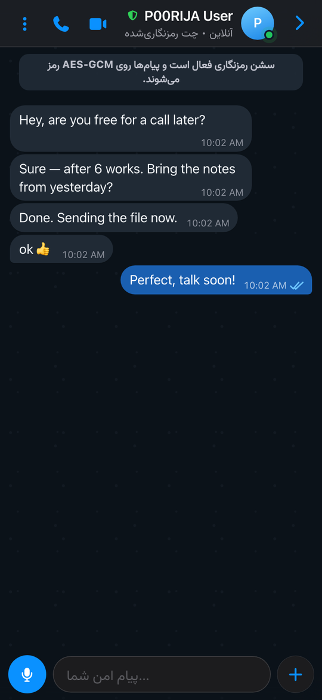
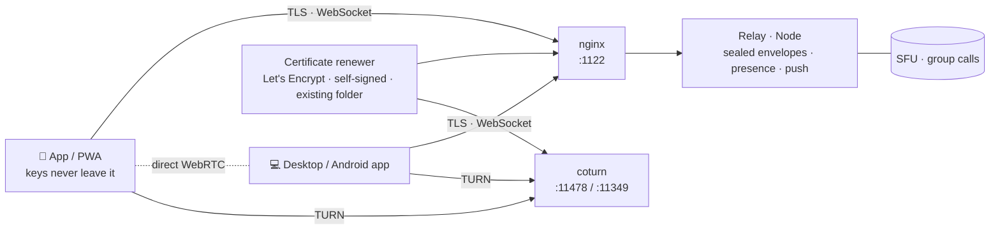

<div align="center">


# P00RIJÃ-CHAT

**End-to-end encrypted chat, voice & video calls and groups — through a server you run yourself.**<br>
**چت رمزنگاری‌شدهٔ سرتاسری، تماس صوتی و تصویری و گروه — از راه سروری که خودتان اجرا می‌کنید.**

   

[**English**](#-english) · [**فارسی**](#-فارسی) · [Install](#install-the-server) · [Native apps](#native-apps) · [Release notes](RELEASE-NOTES.md) · [Support](#support-the-project--حمایت-از-پروژه)

Version 2.20.23 · build chat-v41 · AGPL-3.0-only

    

 

 

</div>

---

<a id="-english"></a>

# 🇬🇧 English

## Contents

[What it is](#what-it-is) · [Features](#features) · [Security](#security) · [How it fits together](#how-it-fits-together) · [Install the server](#install-the-server) · [Certificates](#certificates-ssl) · [Ports](#ports) · [Update & remove](#update-status-remove) · [Install the app](#install-the-app-on-a-phone-or-computer) · [Native apps](#native-apps) · [Develop](#develop-test-release) · [Documentation](#documentation) · [Support](#support-the-project--حمایت-از-پروژه) · [License](#license)

## What it is

A messenger that looks and works the way a messenger should, whose server cannot
read a thing. It is a **web app** that installs on a phone or a computer, and a
**relay** that you run on your own machine. People on it message, call and make
groups; **no phone number, no account with a company, nothing stored with anybody
else.** Desktop (macOS, Windows, Linux) and Android apps can be built from this
repository as well.

## Features

| | |
|---|---|
| 💬 **Chats** | Text with replies, edits, reactions, forwarding, pins, search, formatting, link previews, drafts, scheduled messages, self-destructing and hidden messages, polls, stickers and GIFs, voice messages, photos, videos and albums, files of any size, a location once or live, contact cards, notes to yourself. |
| 📞 **Calls** | Voice and video, one-to-one and in groups, with screen sharing and an on-call extras menu (hold, picture-in-picture, mirror, devices, screenshot). Direct between the devices when possible, through your own TURN server when not. Encrypted between the people on the call and **verifiable**: the same emoji show on both screens. Each call records the road it took — *via peer* or *via relay* — in the chat and in the call log. |
| 👥 **Groups** | Roles and permissions, mentions, invitations, group calls through an SFU. A group put on you by a stranger waits under *Requests* until you say yes. |
| 📡 **Local** | Chat and calls with people on the same Wi-Fi, with no server at all. |
| 🔔 **Toasts** | A burst of messages is *one* notice per conversation that counts as it grows (“3 stickers, 1 message”); different people stay separate. |
| 🔕 **What a notification says** | By default only “an encrypted message arrived”. Two switches in Settings → Notifications and sounds, both off: the **sender’s name** and the **message or the kind of media**. They work even with the app closed: the name and text are encrypted under keys only your devices and your contacts hold, so the relay and Google/Apple never read them. |
| ⚙️ **Settings** | Telegram / iOS-style pages. Status lines are live; each page opens at its top and remembers where you were when you come back. |
| ◀️ **Back / forward** | The system back gesture and button (Android, browser, iOS edge swipe) walk back through the app’s screens — a conversation, a Settings page, the list — instead of leaving the app; forward goes the other way. A call in full screen is minimised, never hung up. |
| 🎨 **Interface** | The tabs and list of Telegram and WhatsApp, drawn with the glass and motion of iOS 26. Light and dark, **Persian (RTL) and English**, phone and desktop. |
| 🛡️ **Server** | Four containers (app, relay, TURN, certificate renewer), a monitoring dashboard, several servers and clusters, background push (Web Push, UnifiedPush). |

## Security

- **A post-quantum key exchange.** Every live conversation is keyed from an ECDH
  P-256 secret and an **ML-KEM-768** secret together, signed by both sides, so it
  falls only if both do. The same goes for the seal on a message left for somebody
  who is away. A **Double Ratchet** gives a key per message.
- **Forward secrecy, no downgrade** (a contact that can do the better exchange is
  never offered the worse), signed prekeys, a relay that cannot be used to open
  anything, and key-transparency heads signed by a key kept only for that.
- **A vault.** Everything on the device is encrypted under your master password
  (Argon2id + AES-256-GCM), with a **decoy profile** for a password you are made
  to give.
- **Keys you can check.** Safety numbers as emoji or a QR code; a key that
  changes is said so and, for someone you have verified, blocks sending.
- **A server that holds sealed envelopes**, who is connected, and nothing else.

[docs/PROTOCOL.md](docs/PROTOCOL.md) and [docs/SPEC.md](docs/SPEC.md) say exactly
what is done and what is not. **The app has not had an independent security audit.**
Report a weakness privately: [SECURITY.md](SECURITY.md).

## How it fits together



## Install the server

You need a Linux server (Debian, Ubuntu, Fedora, Arch, Alpine, … any with Docker),
about **1.5 GB** of free disk and, for a public install, a **domain name or a
public IP**. Everything else — Git, Docker, the certificate — the installer does.

### One line (recommended)

```bash
curl -fsSL https://raw.githubusercontent.com/Poorija/P00RIJA-CHAT/main/install.sh | sudo bash
```

It asks, in Persian or English:

1. **Easy install** — three short questions (where will people reach it: a domain,
   the server’s public IP, or this machine/LAN only; an e-mail for Let’s Encrypt;
   the port) — **or Custom install**, the full wizard with every option.
2. If a certificate for your domain is already on the server (3X-UI, certbot,
   acme.sh, …) it **finds it and offers it** before anything is issued.

Without questions:

```bash
# a domain, with a Let's Encrypt certificate
curl -fsSL https://raw.githubusercontent.com/Poorija/P00RIJA-CHAT/main/install.sh | sudo bash -s -- --easy --domain chat.example.com --email you@example.com

# a public IP address (Let's Encrypt issues 6-day certificates for addresses and renews them)
curl -fsSL https://raw.githubusercontent.com/Poorija/P00RIJA-CHAT/main/install.sh | sudo bash -s -- --easy --ip 203.0.113.7

# this machine and this network only (self-signed)
curl -fsSL https://raw.githubusercontent.com/Poorija/P00RIJA-CHAT/main/install.sh | sudo bash -s -- --easy --local

# the full wizard
curl -fsSL https://raw.githubusercontent.com/Poorija/P00RIJA-CHAT/main/install.sh | sudo bash -s -- --custom
```

Or clone it and run it yourself (read it first — it is plain bash):

```bash
git clone https://github.com/Poorija/P00RIJA-CHAT.git && cd P00RIJA-CHAT
sudo bash install.sh              # or: sudo bash install.sh --custom
```

When it finishes it prints the address, the dashboard and where the dashboard
password is kept (`.env`, mode 600).

| Option | |
|---|---|
| `--easy` / `--custom` | a few questions / the full wizard |
| `--domain NAME` · `--ip ADDRESS` · `--local` | where people reach it |
| `--port N` | the public port (default **1122**) |
| `--email ADDRESS` | for Let’s Encrypt expiry notices |
| `--letsencrypt` · `--self-signed` · `--cert-dir DIR` | [certificate](#certificates-ssl) |
| `--password TEXT` | the dashboard password, 12+ characters (generated otherwise) |
| `--peers "<id>@<origin>,…"` | relays this one carries for ([docs/RELAY-NETWORK.md](docs/RELAY-NETWORK.md)) |
| `--dir DIR` | install folder (`/opt/p00rija-chat` as root) |
| `--version v2.20.23` · `--branch NAME` | a release or a branch instead of `main` |
| `--lang fa\|en` · `--no-start` · `--yes` | language · configure only · never ask |

Other ways to install: the Docker images ([docker/README.dockerhub.md](docker/README.dockerhub.md),
`scripts/docker-install.sh`), or by hand ([INSTALL-LINUX-SERVER.md](INSTALL-LINUX-SERVER.md)).

### Certificates (SSL)

One folder holds the certificate; nginx, TURN and the relay read it in place and the
**certificate renewer** container keeps it.

| Situation | What happens |
|---|---|
| **Domain, public** | Let’s Encrypt, issued at start-up and **renewed 10 days before expiry**, automatically. |
| **Public IP** | Let’s Encrypt for the address — 6-day certificates, renewed with 2 days left (port 80 must reach the server). |
| **Local / LAN / no domain** | A self-signed certificate for `localhost` and every address the machine has; made again by itself before it runs out. Browsers warn once. |
| **A certificate the server already has** (`--cert-dir /root/cert/chat.example.com`, or chosen from the list the installer shows) | Served **from where it is**. Whoever renews it (3X-UI, certbot, acme.sh, …) keeps renewing it for both — nothing is copied. |
| …and you want *this* stack to renew it there | add `--letsencrypt` to `--cert-dir`. |

### Ports

| Port | | What | Open |
|---|---|---|---|
| **1122** | TCP | App, relay, dashboard (`/Monitor_Server`) | yes |
| 80 | TCP | Let’s Encrypt, only while a certificate is issued | during issuing |
| 11478 | TCP+UDP | TURN | yes, for calls |
| 11349 | TCP | TURN over TLS | yes, for calls |
| 40000–40500 | UDP | TURN relay range | yes, for calls |
| 11220–11222 | TCP | The relay’s own ports | **no** (loopback / proxy only) |

They sit beside other stacks on the same machine (own project name, container names
`P00RIJA-Chat_*`, network and ports).

### Update, status, remove

```bash
curl -fsSL https://raw.githubusercontent.com/Poorija/P00RIJA-CHAT/main/install.sh | sudo bash -s -- update      # keeps .env, certificates, data, volumes
curl -fsSL https://raw.githubusercontent.com/Poorija/P00RIJA-CHAT/main/install.sh | sudo bash -s -- status
curl -fsSL https://raw.githubusercontent.com/Poorija/P00RIJA-CHAT/main/install.sh | sudo bash -s -- uninstall   # add --purge to delete data too
```

Several servers, clusters, TURN near your users, a central panel: [docs/RELAY-NETWORK.md](docs/RELAY-NETWORK.md),
[docs/MONITOR-SERVER.md](docs/MONITOR-SERVER.md).

## Install the app on a phone or computer

Open your server’s address (`https://your-server:1122`) and install it:

| Where | How |
|---|---|
| iPhone, iPad (Safari) | Share → **Add to Home Screen** (notifications from iOS 16.4, home-screen app only). |
| Android (Chrome) | Menu → **Install app**. |
| Windows, macOS, Linux (Chrome, Edge) | The install icon in the address bar. |

First run: choose a language → make a **master password** (it cannot be recovered)
→ your identity is made for you → add someone by **scanning** their QR code, or
exchange a card and compare the emoji safety number over a call. Full guide:
[INSTALL.md](INSTALL.md).

## Native apps

Desktop (macOS, Windows, Linux) and Android apps, built with Tauri 2 from this
repository. They are not signed for distribution. For iOS the build produces the
Xcode project, zipped with the steps to sign it with your own Apple identity; nothing
is signed or built for you.

```bash
bash build-native.sh                  # a menu
bash build-native.sh mac universal    # .app and .dmg (on a Mac)
bash build-native.sh windows          # NSIS installer, in Docker, from any host
bash build-native.sh linux            # .deb .rpm .AppImage, in Docker
bash build-native.sh android          # APK + AAB (needs the Android SDK/NDK)
bash build-native.sh ios              # the Xcode project to sign yourself (on a Mac)
bash build-native.sh all              # everything this machine can (45–90 min)
bash build-native.sh check            # what this machine is missing
```

Results land in `Export/` with `SHA256SUMS.txt`; `Export/GitHub/` is exactly what to
attach to a GitHub release (`scripts/github-release-files.sh`): the files, `SHA256SUMS.txt`
and a `RELEASE-NOTES.md` with a which-file-for-which-machine table and every release since
1.0.0. The apps check GitHub for a newer release themselves (Settings → About me; the
check can be switched off) and download the file for their own architecture —
universal, Apple silicon or Intel, x64 or ARM64, .deb, .rpm, AppImage — verified
against `SHA256SUMS.txt`. The older wizard:
`bash scripts/native-build-wizard.sh`.

## Develop, test, release

```bash
npm install
PORT=8123 npm run dev                                   # the web app
MONITOR_PASSWORD='at-least-twelve-characters' npm run relay
npm run test:all                                        # guards + core suites
node tests/regression.mjs --workers 3                   # the full gate: every suite on its own stack
node tests/regression.mjs --only calls,settings         # some
```

- Code: classic scripts in `js/` (`js/chat/` is the messenger in 68 ordered parts),
  styles from `css/ui/*.css` (`node tools/build-ui-css.cjs`), relay in `scripts/`.
- 245 end-to-end suites drive real browsers against an isolated relay each
  ([docs/SUITES.md](docs/SUITES.md), [docs/REGRESSION.md](docs/REGRESSION.md)).
- A release is a change commit and a `release:` commit that only moves the version
  (`npm run check:versions`), a signed tag, and provenance for the server images
  (`npm run release:verify -- <version>`).
- Publish-safe copy of the tree: `bash scripts/build-github-folder.sh` (scrubbed,
  verified) and `bash scripts/sync-github-desktop.sh`.

## Documentation

[INSTALL.md](INSTALL.md) · [INSTALL-LINUX-SERVER.md](INSTALL-LINUX-SERVER.md) ·
[docs/PROTOCOL.md](docs/PROTOCOL.md) · [docs/SPEC.md](docs/SPEC.md) ·
[docs/DESIGN.md](docs/DESIGN.md) · [docs/DEVELOPMENT.md](docs/DEVELOPMENT.md) ·
[docs/RELAY-NETWORK.md](docs/RELAY-NETWORK.md) · [docs/MONITOR-SERVER.md](docs/MONITOR-SERVER.md) ·
[docs/REGRESSION.md](docs/REGRESSION.md) · [CONTRIBUTING.md](CONTRIBUTING.md) ·
[SECURITY.md](SECURITY.md) · [RELEASE-NOTES.md](RELEASE-NOTES.md)

---

<a id="-فارسی"></a>

<div dir="rtl">

# 🇮🇷 فارسی

## فهرست

[چیست؟](#چیست) · [امکانات](#امکانات) · [امنیت](#امنیت) · [نصب سرور](#نصب-سرور) · [گواهی SSL](#گواهی-ssl) · [پورت‌ها](#پورتها) · [به‌روزرسانی و حذف](#بهروزرسانی-وضعیت-حذف) · [نصب برنامه](#نصب-برنامه-روی-گوشی-یا-کامپیوتر) · [برنامه‌های بومی](#برنامههای-بومی) · [توسعه](#توسعه-و-آزمون) · [مستندات](#مستندات) · [حمایت](#support-the-project--حمایت-از-پروژه) · [مجوز](#مجوز)

## چیست؟

یک پیام‌رسان که ظاهر و رفتارش همان است که از یک پیام‌رسان انتظار دارید، و **سرورش چیزی از پیام‌ها نمی‌خواند.** یک **وب‌اپ** است که روی گوشی یا کامپیوتر نصب می‌شود، و یک **رله** که روی ماشین خودتان اجرا می‌کنید. نه شمارهٔ تلفن می‌خواهد، نه حساب نزد شرکتی؛ چیزی پیش کسی ذخیره نمی‌شود. برنامه‌های دسکتاپ (macOS، Windows، Linux) و Android را هم می‌شود از همین مخزن ساخت.

## امکانات

| | |
|---|---|
| 💬 **چت** | پاسخ، ویرایش، واکنش، هدایت، پین، جستجو، قالب‌بندی، پیش‌نمایش پیوند، پیش‌نویس، ارسال زمان‌بندی‌شده، پیام خودتخریب و مخفی، نظرسنجی، استیکر و گیف، پیام صوتی، عکس و ویدیو و آلبوم، فایل با هر حجم، موقعیت (یک‌باره یا زنده)، کارت مخاطب، یادداشت برای خودتان. |
| 📞 **تماس** | صوتی و تصویری، یک‌به‌یک و گروهی، با اشتراک صفحه و منوی ابزارهای تماس (هولد، تصویر در تصویر، آینه، دستگاه‌ها، اسکرین‌شات). تا جای ممکن مستقیم بین دو دستگاه، وگرنه از راه TURN خودتان. بین شرکت‌کنندگان رمزنگاری شده و **قابل‌راستی‌آزمایی**: همان ایموجی‌ها روی هر دو صفحه. مسیر هر تماس — *از طریق Peer* یا *از طریق رله* — در گفتگو و در لاگ تماس نوشته می‌شود. |
| 👥 **گروه** | نقش و دسترسی، منشن، دعوت، تماس گروهی با SFU. گروهی که غریبه‌ای شما را در آن بگذارد تا نپذیرید زیر «درخواست‌ها» می‌ماند. |
| 📡 **محلی** | چت و تماس با کسانی که روی همان Wi‑Fi هستند، بدون هیچ سرور. |
| 🔔 **اعلان درون‌برنامه** | هجوم پیام‌ها برای هر گفتگو **یک** اعلان است که با رسیدن پیام‌های تازه می‌شمارد («۳ استیکر و ۱ پیام»)؛ افراد مختلف جدا می‌مانند. |
| 🔕 **محتوای اعلان** | پیش‌فرض فقط «پیام رمزنگاری‌شده‌ای رسید». دو سوییچ در تنظیمات ← اعلان‌ها و صداها، هر دو خاموش: **نام فرستنده** و **متن پیام یا نوع رسانه**. حتی با برنامهٔ بسته کار می‌کنند: نام و متن با کلیدی رمز می‌شوند که فقط دستگاه‌های شما و مخاطبان‌تان دارند؛ رله و گوگل/اپل آن را نمی‌خوانند. |
| ⚙️ **تنظیمات** | صفحه‌ها به سبک تلگرام/iOS. وضعیت‌ها زنده‌اند؛ هر صفحه از بالا باز می‌شود و موقع برگشت به همان جایی می‌رود که بودید. |
| ◀️ **عقب / جلو** | ژست و دکمهٔ برگشت سیستم (Android، مرورگر، لبه‌کشی iOS) به‌جای خروج از برنامه، یک صفحه به عقب می‌رود — گفتگو، صفحهٔ تنظیمات، فهرست — و جلو برعکس. تماسِ تمام‌صفحه کوچک می‌شود و هرگز قطع نمی‌شود. |
| 🎨 **ظاهر** | تب‌ها و فهرست تلگرام و واتس‌اپ، با شیشه و حرکت iOS 26. روشن و تیره، **فارسی (راست‌به‌چپ) و انگلیسی**، موبایل و دسکتاپ. |
| 🛡️ **سرور** | چهار کانتینر (برنامه، رله، TURN، تمدیدکنندهٔ گواهی)، داشبورد مانیتورینگ، چند سرور و خوشه، اعلان پس‌زمینه (Web Push، UnifiedPush). |

## امنیت

- **تبادل کلید پساکوانتومی.** کلید هر گفتگوی زنده از دو راز با هم ساخته می‌شود، ECDH P‑256 و **ML‑KEM‑768**، و هر دو طرف آن را امضا می‌کنند؛ پس فقط وقتی می‌شکند که هر دو بشکنند. مهر پیامی که برای کسی که آنلاین نیست می‌ماند هم همین‌طور. **Double Ratchet** برای هر پیام کلیدی جدا می‌دهد.
- **محرمانگی رو به جلو و بدون «پایین‌کشیدن» نسخه** (مخاطبی که تبادل بهتر را بلد است هرگز به بدتر برنمی‌گردد)، prekey امضاشده، رله‌ای که نمی‌شود با آن چیزی را باز کرد، و سرهای شفافیت کلید که با کلیدی مخصوص امضا می‌شوند.
- **گاوصندوق.** همهٔ داده‌های روی دستگاه زیر رمز اصلی شما رمز می‌شود (Argon2id و AES‑256‑GCM)، با **پروفایل فریب** برای رمزی که مجبور به گفتنش شوید.
- **کلیدهایی که می‌شود وارسی کرد.** شمارهٔ امنیتی به شکل ایموجی یا QR؛ کلیدی که عوض شود اعلام می‌شود و برای کسی که تأییدش کرده‌اید جلوی ارسال را می‌گیرد.
- **سروری که فقط پاکت‌های مهرشده، فهرست متصل‌ها و هیچ چیز دیگری دارد.**

جزئیات دقیق و آنچه هنوز انجام نشده: [docs/PROTOCOL.md](docs/PROTOCOL.md) و [docs/SPEC.md](docs/SPEC.md). **برنامه هنوز ممیزی امنیتی مستقل ندیده است.** گزارش ضعف امنیتی را خصوصی بفرستید: [SECURITY.md](SECURITY.md).

## نصب سرور

یک سرور Linux (Debian، Ubuntu، Fedora، Arch، Alpine و …)، حدود **۱٫۵ گیگابایت** فضای خالی، و برای نصب عمومی یک **نام دامنه یا IP عمومی** لازم است. بقیه — Git، Docker، گواهی — را نصب‌کننده انجام می‌دهد.

### یک خط (پیشنهادی)

```bash
curl -fsSL https://raw.githubusercontent.com/Poorija/P00RIJA-CHAT/main/install.sh | sudo bash
```

به فارسی یا انگلیسی می‌پرسد:

1. **نصب آسان** — سه سؤال کوتاه (مردم از کجا وصل می‌شوند: دامنه، IP عمومی سرور، یا فقط همین دستگاه/شبکهٔ محلی؛ ایمیل برای Let’s Encrypt؛ پورت) — **یا نصب سفارشی**، ویزارد کامل با همهٔ گزینه‌ها.
2. اگر گواهی دامنه‌تان از قبل روی سرور باشد (3X‑UI، certbot، acme.sh و …) **پیدا می‌کند و پیشنهاد می‌دهد** پیش از آنکه چیزی صادر شود.

بدون سؤال:

```bash
# دامنه با گواهی Let's Encrypt
curl -fsSL https://raw.githubusercontent.com/Poorija/P00RIJA-CHAT/main/install.sh | sudo bash -s -- --easy --domain chat.example.com --email you@example.com

# IP عمومی (Let's Encrypt برای آدرس‌ها گواهی ۶ روزه می‌دهد و خودش تمدید می‌کند)
curl -fsSL https://raw.githubusercontent.com/Poorija/P00RIJA-CHAT/main/install.sh | sudo bash -s -- --easy --ip 203.0.113.7

# فقط همین دستگاه و شبکهٔ محلی (خودامضا)
curl -fsSL https://raw.githubusercontent.com/Poorija/P00RIJA-CHAT/main/install.sh | sudo bash -s -- --easy --local

# ویزارد کامل
curl -fsSL https://raw.githubusercontent.com/Poorija/P00RIJA-CHAT/main/install.sh | sudo bash -s -- --custom
```

یا کلون کنید و خودتان اجرا کنید (اول بخوانیدش — bash ساده است):

```bash
git clone https://github.com/Poorija/P00RIJA-CHAT.git && cd P00RIJA-CHAT
sudo bash install.sh
```

در پایان آدرس برنامه، داشبورد و جای رمز داشبورد (`.env` با دسترسی ۶۰۰) را چاپ می‌کند.

| گزینه | |
|---|---|
| `--easy` / `--custom` | چند سؤال / ویزارد کامل |
| `--domain NAME` · `--ip ADDRESS` · `--local` | مردم از کجا وصل می‌شوند |
| `--port N` | پورت عمومی (پیش‌فرض **۱۱۲۲**) |
| `--email ADDRESS` | برای اطلاع انقضا از Let’s Encrypt |
| `--letsencrypt` · `--self-signed` · `--cert-dir DIR` | [گواهی](#گواهی-ssl) |
| `--password TEXT` | رمز داشبورد، حداقل ۱۲ نویسه (وگرنه ساخته می‌شود) |
| `--peers "<id>@<origin>,…"` | رله‌هایی که این یکی برایشان پیام می‌رساند ([docs/RELAY-NETWORK.md](docs/RELAY-NETWORK.md)) |
| `--dir DIR` | پوشهٔ نصب (برای root: `/opt/p00rija-chat`) |
| `--version v2.20.23` · `--branch NAME` | یک انتشار یا شاخه به‌جای `main` |
| `--lang fa\|en` · `--no-start` · `--yes` | زبان · فقط تنظیم، بدون راه‌اندازی · هیچ‌چیز نپرس |

راه‌های دیگر: ایمیج‌های Docker ([docker/README.dockerhub.md](docker/README.dockerhub.md)، `scripts/docker-install.sh`)، یا دستی ([INSTALL-LINUX-SERVER.md](INSTALL-LINUX-SERVER.md)).

### گواهی SSL

گواهی در یک پوشه است؛ nginx و TURN و رله همان‌جا می‌خوانند و کانتینر **تمدیدکنندهٔ گواهی** نگهدارش است.

| وضعیت | چه می‌شود |
|---|---|
| **دامنهٔ عمومی** | Let’s Encrypt، هنگام راه‌اندازی صادر و **۱۰ روز پیش از انقضا خودکار تمدید** می‌شود. |
| **IP عمومی** | Let’s Encrypt برای آدرس — گواهی ۶ روزه که با ۲ روز مانده تمدید می‌شود (پورت ۸۰ باید به سرور برسد). |
| **محلی / شبکهٔ خانگی / بی‌دامنه** | گواهی خودامضا برای `localhost` و همهٔ آدرس‌های ماشین؛ پیش از تمام‌شدن خودش دوباره ساخته می‌شود. مرورگر یک‌بار هشدار می‌دهد. |
| **گواهی‌ای که سرور از قبل دارد** (`--cert-dir /root/cert/chat.example.com` یا انتخاب از فهرست نصب‌کننده) | **از همان‌جا** خدمت می‌شود. هر که تمدیدش می‌کند (3X‑UI، certbot، acme.sh و …) برای هر دو تمدید می‌کند — چیزی کپی نمی‌شود. |
| …و می‌خواهید **همین استک** همان‌جا تمدیدش کند | به `--cert-dir`، گزینهٔ `--letsencrypt` را اضافه کنید. |

### پورت‌ها

| پورت | | چیست | باز؟ |
|---|---|---|---|
| **۱۱۲۲** | TCP | برنامه، رله، داشبورد (`/Monitor_Server`) | بله |
| ۸۰ | TCP | Let’s Encrypt، فقط هنگام صدور | هنگام صدور |
| ۱۱۴۷۸ | TCP+UDP | TURN | بله، برای تماس |
| ۱۱۳۴۹ | TCP | TURN روی TLS | بله، برای تماس |
| ۴۰۰۰۰–۴۰۵۰۰ | UDP | بازهٔ رله‌ی TURN | بله، برای تماس |
| ۱۱۲۲۰–۱۱۲۲۲ | TCP | پورت‌های خود رله | **نه** (فقط loopback / پراکسی) |

کنار برنامه‌های دیگر روی همان ماشین می‌نشیند (نام پروژه، نام کانتینرها `P00RIJA-Chat_*`، شبکه و پورت‌های خودش).

### به‌روزرسانی، وضعیت، حذف

```bash
curl -fsSL https://raw.githubusercontent.com/Poorija/P00RIJA-CHAT/main/install.sh | sudo bash -s -- update      # .env، گواهی‌ها، داده‌ها و volumeها حفظ می‌شود
curl -fsSL https://raw.githubusercontent.com/Poorija/P00RIJA-CHAT/main/install.sh | sudo bash -s -- status
curl -fsSL https://raw.githubusercontent.com/Poorija/P00RIJA-CHAT/main/install.sh | sudo bash -s -- uninstall   # با --purge داده‌ها هم پاک می‌شود
```

چند سرور، خوشه، TURN نزدیک کاربران، پنل مرکزی: [docs/RELAY-NETWORK.md](docs/RELAY-NETWORK.md)، [docs/MONITOR-SERVER.md](docs/MONITOR-SERVER.md).

## نصب برنامه روی گوشی یا کامپیوتر

آدرس سرورتان را باز کنید (`https://your-server:1122`) و نصبش کنید:

| کجا | چطور |
|---|---|
| iPhone و iPad (Safari) | Share ← **Add to Home Screen** (اعلان از iOS 16.4 و فقط برای برنامهٔ صفحهٔ اصلی). |
| Android (Chrome) | منو ← **Install app**. |
| Windows و macOS و Linux (Chrome و Edge) | آیکن نصب در نوار آدرس. |

اولین بار: زبان ← **رمز اصلی** (بازیابی ندارد) ← هویت شما خودکار ساخته می‌شود ← کسی را با **اسکن QR** او اضافه کنید، یا کارت را بفرستید و ایموجی شمارهٔ امنیتی را در یک تماس با هم تطبیق دهید. راهنمای کامل: [INSTALL.md](INSTALL.md).

## برنامه‌های بومی

برنامهٔ دسکتاپ (macOS، Windows، Linux) و Android، با Tauri 2 از همین مخزن ساخته می‌شود. برای توزیع امضا نشده‌اند. برای iOS پروژهٔ Xcode (zip) با راهنمای امضا با هویت Apple خودتان ساخته می‌شود؛ چیزی برایتان بیلد یا امضا نمی‌شود.

```bash
bash build-native.sh                  # منو
bash build-native.sh mac universal    # .app و .dmg (روی Mac)
bash build-native.sh windows          # نصب‌کنندهٔ NSIS، در Docker، از هر میزبانی
bash build-native.sh linux            # .deb .rpm .AppImage، در Docker
bash build-native.sh android          # APK و AAB (به Android SDK/NDK نیاز دارد)
bash build-native.sh ios              # پروژهٔ Xcode برای امضای خودتان (روی Mac)
bash build-native.sh all              # هرچه این ماشین بتواند (۴۵ تا ۹۰ دقیقه)
bash build-native.sh check            # چه چیزی کم است
```

خروجی در `Export/` با `SHA256SUMS.txt` است؛ `Export/GitHub/` دقیقاً همان است که به انتشار GitHub پیوست می‌شود (`scripts/github-release-files.sh`): فایل‌ها، `SHA256SUMS.txt` و `RELEASE-NOTES.md` با جدول «کدام فایل برای کدام دستگاه» و تاریخچهٔ همهٔ انتشارها از 1.0.0. برنامه خودش از GitHub نسخهٔ تازه را می‌پرسد (تنظیمات ← دربارهٔ من؛ قابل خاموش‌شدن) و فایل معماری خودش را (universal، Apple silicon یا Intel، x64 یا ARM64، deb، rpm، AppImage) دانلود و با `SHA256SUMS.txt` می‌سنجد.

## توسعه و آزمون

```bash
npm install
PORT=8123 npm run dev
MONITOR_PASSWORD='at-least-twelve-characters' npm run relay
npm run test:all
node tests/regression.mjs --workers 3        # دروازهٔ کامل: هر سوییت روی استک جداگانه
```

- کد: اسکریپت‌های کلاسیک در `js/` (`js/chat/` پیام‌رسان در ۶۸ بخش مرتب است)، استایل از `css/ui/*.css` (`node tools/build-ui-css.cjs`)، رله در `scripts/`.
- ۲۴۵ سوییت end‑to‑end با مرورگر واقعی و رلهٔ جدا برای هر سوییت ([docs/SUITES.md](docs/SUITES.md)، [docs/REGRESSION.md](docs/REGRESSION.md)).
- انتشار یعنی یک کامیت تغییر، یک کامیت `release:` که فقط نسخه را عوض می‌کند، تگ امضاشده، و گواهی منشأ ایمیج‌های سرور (`npm run release:verify -- <version>`).
- نسخهٔ امن برای انتشار از درخت: `bash scripts/build-github-folder.sh` و `bash scripts/sync-github-desktop.sh`.

## مستندات

[INSTALL.md](INSTALL.md) · [INSTALL-LINUX-SERVER.md](INSTALL-LINUX-SERVER.md) · [docs/PROTOCOL.md](docs/PROTOCOL.md) · [docs/SPEC.md](docs/SPEC.md) · [docs/DESIGN.md](docs/DESIGN.md) · [docs/DEVELOPMENT.md](docs/DEVELOPMENT.md) · [docs/RELAY-NETWORK.md](docs/RELAY-NETWORK.md) · [docs/MONITOR-SERVER.md](docs/MONITOR-SERVER.md) · [docs/REGRESSION.md](docs/REGRESSION.md) · [CONTRIBUTING.md](CONTRIBUTING.md) · [SECURITY.md](SECURITY.md) · [RELEASE-NOTES.md](RELEASE-NOTES.md)

</div>

---

<a id="support-the-project--حمایت-از-پروژه"></a>

## Support the project · حمایت از پروژه

If this has been useful, you can send **TON** from **Telegram Wallet**. اگر این پروژه برایتان مفید بود، می‌توانید با **TON** از طریق **کیف پول تلگرام** حمایت کنید.

```text
UQCEgGxRZ5A101w6RBNLwHhnva5EdK3kyDsFQcxni35DlCJf
```

[Open in Telegram Wallet · باز کردن در کیف پول](ton://transfer/UQCEgGxRZ5A101w6RBNLwHhnva5EdK3kyDsFQcxni35DlCJf) — the same address is in the app: *Settings → About me → Support the project*.

## License

**GNU Affero General Public License, version 3 only** — see [LICENSE](LICENSE). Section 13 applies: run a modified version as a network service and its users are entitled to your source. · **مجوز:** AGPL نسخهٔ ۳ (فقط)؛ بند ۱۳: اگر نسخهٔ تغییریافته را به‌عنوان سرویس شبکه اجرا کنید، کاربرانش حق دارند به کد منبع آن دسترسی داشته باشند.

Copyright © 2026 Poorija &lt;p00rija@tutamail.com&gt;

It started as the secure chat of *P00RIJA Cryptography* and is now a project of its own, with its own repository, port, containers, settings and releases.
